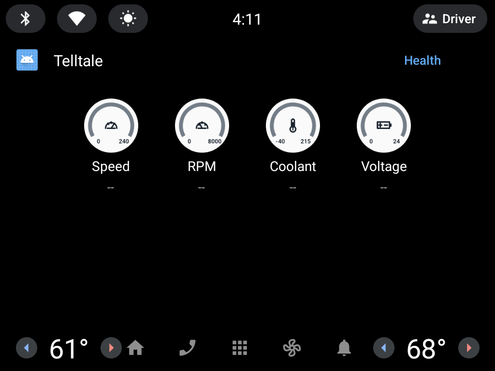
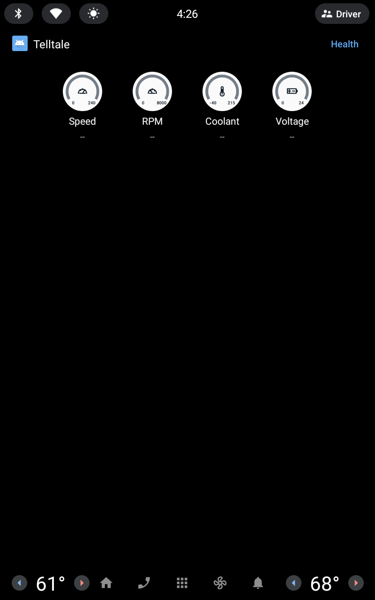
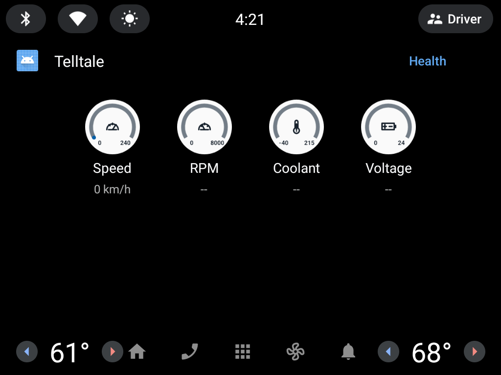

# AA-10 — Grid dashboard prototype

Status: **PARTIAL** (2026-10-13; visual pass 2026-11-01, see
[Visual pass and projected DHU measurements](#visual-pass-and-projected-dhu-measurements)).
Local native/Flutter regressions, protected
contracts and three debug builds passed. AAOS lint remains **FAIL_FATAL** with
one reproduced baseline error; host acceptance and feature CI remain incomplete.
Google production category review remains **CATEGORY_FIT_UNRESOLVED**.
This record is separate from the historical [AA-09 Pane evidence](aa-09-graphics-verification.md).

## Implementation

`TelltaleCarSession` launches `CarHomeScreen(graphicalDashboard = true)`.
Graphical Home builds the official `GridTemplate` with fixed-priority Speed,
RPM, Coolant and Voltage items. The English Grid uses the shorter Voltage title
to avoid observed host ellipsis; the numerical Pane retains Module Voltage, and
zh-TW/zh-CN retain 模組電壓/模块电压. Each item has a localized stable title,
a native secondary reading/status, and a supplementary Bitmap gauge image.
No custom driving Surface, navigation category, permission, dependency or
experimental chart/progress API is added. Car App Library remains pinned at
`1.8.0-rc01`.

The graphical screen queries `ConstraintManager.CONTENT_LIMIT_TYPE_GRID` once
and uses a positive limit capped at four. The resulting count is fixed for the
screen's lifetime, including unsupported PID, missing, stale and disconnected
states. An exception or nonpositive result selects the existing numerical Pane
fallback. The numerical path still uses its own Pane content limit. Direct Home
construction defaults to Pane, retaining baseline behavior and regression coverage.

Each Grid item opens numerical Values Home with Back and Powertrain actions.
Grid's named Health header action opens Health directly, retaining Powertrain
and parked diagnostic navigation. The deepest static path is Grid → Health →
DTC Summary → Detail: four templates. Grid → Values → Powertrain uses three,
and Values has no Health intermediate action. The original numerical fallback
Home retains Health access. These clicks browse read-only data; adapter setup,
PID editing/reordering, DTC
clearing and vehicle commands are not added. Existing motion gates remain in effect.

## Official template constraints

The [IoT guide](https://developer.android.com/training/cars/apps/iot) recommends
GridTemplate for device lists and interaction. This supports the template choice;
it does not resolve OBD telemetry's IoT category fit.

The [task template restrictions](https://developer.android.com/training/cars/apps/library/template-restrictions)
allow up to five templates, but require the fifth to be NavigationTemplate,
PaneTemplate, MessageTemplate, MediaPlaybackTemplate, SignInTemplate or
LongMessageTemplate. ListTemplate is absent from that terminal list. Both DTC
Summary and Detail remain ListTemplate, so the static diagnostic path uses at
most four templates by opening Health directly from Grid. Counting screens alone
is insufficient: non-refresh template changes also consume steps. The design
does not call quota-reset APIs or alter the protected DTC contracts to evade this
limit. Existing changes to a non-loading DTC Summary's item count can consume
additional steps; that behavior remains a host-validation gap. A four-template
static path is not a claim that the entire task quota behavior passed acceptance.
Actual host task-step and Back behavior remain verification requirements.

[GridTemplate refresh rules](https://developer.android.com/reference/androidx/car/app/model/GridTemplate)
require an unchanged template title, item count and item titles, except when the
previous template was loading. Readings and state stay in secondary text and
images. Missing/unsupported signals do not remove items, and live values do not
change titles. The implementation retains approximately 1 Hz model-diff refresh,
immediate refresh for semantic alert transitions, and cancellation of collectors
and pending refresh work when the screen stops. There is no autonomous graphics
refresh loop.

The [Grid UX guidance](https://developer.android.com/design/ui/cars/guides/templates/grid-template)
recommends an action for each item and short primary/secondary text. Item clicks
open the retained values page. Secondary text is a single line and can truncate;
localized warning/freshness copy and RTL numeric isolation need verification.

The official Grid content limit is at least six, but apps still query the actual
host limit and must not rely on overflow items: the host can ignore them.
Verification includes smaller positive limits defensively; implementation caps at four.
[ConstraintManager](https://developer.android.com/reference/androidx/car/app/constraints/ConstraintManager)
also documents host query failure. A successful model construction is not proof
that every head unit supports the same layout.

[GridItem](https://developer.android.com/reference/androidx/car/app/model/GridItem)
recommends a 128 × 128 **dp** image bounding box, with proportional downscaling
when needed. Since the 2026-11-01 visual pass the Bitmap is 128 dp at the car
screen's density (`CarContext` resources describe the car display), capped at
2.5× (320 px). The host still controls displayed size and column count; on
Android Auto 17.9 it drew 64 × 64 dp (see the measurements below). A specific
2 × 2 layout, four large circles or full phone-gauge styling is not guaranteed.
`GridTemplate.Builder.setItemSize(ITEM_SIZE_LARGE)` (Car API 8) is requested only
when the negotiated Car API level is at least 8; it is resolved once per screen
and does not change titles, item count or order. Image-shape APIs are not used.
`CarProgressBar` requires Car API 9, is experimental and excludes secondary text;
it is not used.

The [GridItem.Builder reference](https://developer.android.com/reference/androidx/car/app/model/GridItem.Builder)
permits Bitmap-backed CarIcon images. Snapshots use Bitmap rather than mutating
the contents of a reused URI, which can be cached by the host. Current online
references include APIs newer than the pinned library; implementation must stay
within the existing dependency and host API contract.

## Graphics and data truth

`CarGaugeGraphic` draws one static snapshot per tile: a dark instrument face, a
track with evenly spaced ticks, a value arc with a pointer, and the tile's
formatted reading as a large numeral with its unit. The numeral is the same
string the native GridItem text shows, from the same `MetricRow`; the native
text remains the authoritative, accessible reading, including localized `--`,
`Stale` and `High`. Endpoint labels and minor ticks were removed in the
2026-11-01 pass because they were illegible at the host's 64 dp image size.
A bounded eight-entry CarIcon cache (key: metric, state, reading, arc, warning,
day/night, pixel size) avoids unbounded retained images; at the 2.5× cap it holds
at most about 3.3 MB. Day and night palettes follow `CarContext.isDarkMode`
and use the phone theme's aqua accent and red fault hues. Both keep a dark face,
because the projected host's template background stayed dark in day mode; night
lowers luminance. `TelltaleCarSession` invalidates the top screen once when
day/night or density changes, because the library does not request a new
template on a configuration change. A warning adds a triangle and a red rim as
well as color.

| Metric | Display scale (ticks only; endpoints unlabelled in the image) | Meaning |
| --- | --- | --- |
| Speed | 0–240 km/h | Visual scale only; not a speed limit or vehicle capability claim |
| RPM | 0–8000 RPM | Visual scale only; not a redline or engine health threshold |
| Coolant | −40–215 °C | Visual scale only; warning decisions remain with the existing alert repository |
| Module Voltage | 0–24 V | Visual scale only; not an inferred charging-system normal range |

Values outside these scales clamp only the arc; the native text and the image
numeral keep the real formatted reading. The only zone drawn is the coolant alert
region from `CarAlertPolicy.DEFAULT_COOLANT.enterThreshold` (105 °C) to the scale
end, as a hatched band; no RPM redline, voltage band or speed zone is drawn. Images do not create telemetry, interpolate
between samples, infer history, or label a vehicle healthy. The existing speed
resolver remains responsible for OBD/host source arbitration. A valid host speed
can still appear when an OBD signal is absent; its source follows the existing
resolver contract, not a guessed substitute.

Missing, unavailable, unsupported, awaiting and incompatible data keep the
existing `--` native text and no value arc; the image draws `--`, plus a
prohibition glyph for unsupported signals. Stale readings keep explicit `Stale`
text and no current-value arc; the image draws `--`, a clock glyph and a dotted
track. Only a LIVE, finite reading draws a numeral, arc or pointer. Zero remains a valid value only when it is an
actual finite live reading. A live minimum gets an endpoint marker; missing
readings get neither an arc nor a marker. Native text is always retained. Existing
coolant warning lifecycle, including unknown-after-warning state, is preserved.
`matchingAlertSnapshot` permits the matching stream epoch's stale state to retain
an established warning after timeout; a different epoch must not inherit it.
Stale data still has explicit stale text and no current-value arc. Images do not
introduce new thresholds or suppress warning state merely because telemetry
stops being Current.

The [car quality guidelines](https://developer.android.com/docs/quality-guidelines/car-app-quality)
prohibit animated elements while driving and restrict image usage. These
snapshots have no animation timer, interpolated needle, flashing or animated
transition, but approximately 1 Hz live-image updates are not asserted to be an
official policy exemption. Image relevance, glanceability and host behavior
remain review/acceptance questions. The [map Surface guide](https://developer.android.com/training/cars/apps/library/draw-maps)
is for Navigation, POI and Weather map content; it is not used for this IoT prototype.

## Local verification

The clean statistics and log-name index are recorded in
[local-verification.json](aa-10/evidence/local-verification.json). Raw logs remain
in the task's sibling `evidence/` directory (`../evidence/` from the repository
root); they are not copied into the repository. No runner network address,
token, credential or absolute personal path is included in the clean receipt.

The feature is based on integrated main `75bc622a0d4e5aa6cc7837b58ae7cfbe69c3bbf1`.
Implementation commits are `2a70ed15e5952b6c5d67fb482b703f7429fb5e6b` and
`89acccfbbb914774fd38f49250906b4498e1038c`; CI configuration is separately
recorded at `4aea4710f98c18afe89855e9c6a615d599b2dfb2`. Results below are local
execution evidence, not a latest feature-pipeline result. The earlier broad
tool gates ran in the initial uncommitted feature working tree based on
`7edc00761886efe092d85a668c5a75b13e14e2b8`. They attest neither a clean baseline
nor the final snapshot; their scope is retained separately.

| Check and scope | Result | Evidence names |
| --- | --- | --- |
| Integrated Flutter regression | PASS — 4386 passed, 23 opt-in skips; analyzer 0 issues | `merged-flutter-tests.log`, `merged-flutter-analyze.log` |
| Required localization | PASS — 12/12; receipt source is `2a70ed15e5952b6c5d67fb482b703f7429fb5e6b` | `merged-l10n-required.log`, `merged-l10n-required/receipt.json` |
| Feature native regression | PASS — car-core 260, field 66, carProto 66; 0 failures/errors/skips in each suite. Includes Grid structure, constraints/fallback, data/warning semantics, stale timeout, renderer and refresh/lifecycle regressions | `android-final-summary.json`, `merged-android-final.log`, `short-title-final.log` |
| Native lint and debug builds | PASS — car-core lint 0 errors/6 warnings; field and carProto lint each 0 errors/12 warnings; field, carProto and automotive debug APK builds passed | `android-final-summary.json`, `merged-android-final.log`, `short-title-final.log` |
| AAOS lint | FAIL_FATAL — 1 `Instantiatable` error: `CarAppActivity` must extend Activity; 3 warnings. The unchanged `7edc0076` baseline reproduces the same error in an isolated copy; integration at `75bc622a` did not modify Android sources. This remains a failed gate, without suppression or relaxation | `aaos-lint-final.log`, `baseline-aaos-lint.log` |
| Integrated protected car gates | PASS — car contracts 32; merged-manifest isolation; Pigeon generated-code drift 0 | `final-car-contracts.log`, `merged-manifest-isolation.log`, `merged-pigeon-codegen.log` |
| Earlier feature-working-tree tooling | PASS with HEAD `7edc0076` and initial uncommitted Grid changes — Python tool suite 914, AA-08 pytest 20, mode08 unit 17; mode08-required and WS10-S1 required checks; WS10-S2 native Debug 11/11 and Release 11/11 | `python-tools.log`, `python-aa08-pytest.log`, `python-mode08.log`, `mode08-required.log`, `ws10-s1-required.log`, `ws10-s2-native/summary.json` |
| Project CI configuration | PASS — project CI lint valid, 0 warnings. Tags select existing project runner 57287642 (`r9700x-docker`, online): `r9700x`, `grok-box`, `ondemand`, `telltale`. Main pipeline 2941350409/job 17131555614 demonstrates that runner's Docker executor only; it is not a feature-run result | `ci-lint-result.json`, `runner-9700x.json`, `main-pipeline-jobs.json`, `main-9700x-job-trace.log` |

## Remaining acceptance matrix

Unit/model, renderer and local build checks do not establish projected Android
Auto or physical head-unit acceptance. No protected gate was relaxed.

| Check | Observed evidence and remaining scope | Result |
| --- | --- | --- |
| Owned AAOS layout/function | Final v3 APK installed hash matched on 1024×768 landscape and 800×1280 portrait. Complete day Grid, live host zero marker, tile → numerical Pane → Powertrain, direct Health, unknown-speed block and zero-speed Diagnostic Codes entry observed. No OBD values or codes invented | PASS for these observed simulator cases; other lanes remain unverified |
| Host text and day/night | One bounded change to the documented host GPU produced complete day frames. Night still lost static native/system text while dark gauges remained visible; final portrait night was not repeated | PARTIAL — night readability NOT_VERIFIED; portrait night NOT_RUN |
| Host task quota | Verify actual steps for non-loading DTC Summary item-count changes, loading/refresh transitions and Back operations; static path depth alone does not establish quota acceptance | PENDING — existing dynamic DTC-list behavior remains a host-validation gap |
| Feature CI execution | Project configuration is valid; no feature pipeline result has been created/claimed in this receipt | PENDING |
| Projected DHU | 2026-11-01: DHU 2.0 with a Galaxy Note9 (Android 10, Android Auto 17.9.664044), carProto debug build. Grid, Values and Health rendered; demo-simulator readings, day and night. No warning, stale or unsupported lane on the host. See the visual-pass section | PARTIAL — no-data and demo-live lanes only |
| Physical vehicle/head unit | No real vehicle operation or compatibility acceptance in this task | NOT_RUN |
| Google category/image-policy review | Formal IoT/OBD eligibility and dashboard image review remain unresolved; production promotion is outside this task | NOT_RUN — CATEGORY_FIT_UNRESOLVED |

AAOS work is limited to an owned read-only simulator. Injected VHAL or fixture
values are simulated; they do not become DHU results or real-vehicle evidence.
Historical AA-09 captures remain separate. Theme or size cases without usable
host evidence remain PARTIAL/PENDING or NOT_RUN, not a pass inferred from UI tests.

## Candidate and publication receipt

- AAOS final candidate source: `89acccfbbb914774fd38f49250906b4498e1038c`
- Native-file manifest SHA-256: `683fdb118e9fc9f6c19b458438bb42ecffca1db28ad40729d0000dabee334e2d`
- AAOS candidate v3 APK SHA-256: `45e38320d45ff09edbd66a19d7764bd1e9fa2c818e425ea93f2ae9df149feb70`
- Published code branch: `feature/aa-grid-instruments-20261013`; code push/readback matched `4aea4710f98c18afe89855e9c6a615d599b2dfb2`. Final documentation-tip readback is retained in the task completion receipt.
- Simulator evidence and raw image hashes: [AAOS receipt](aa-10/evidence/aaos/receipt.json). Owned processes, private ADB and runtime data were removed; original AVDs/global ADB were not changed.
- Projected DHU: PARTIAL on 2026-11-01 (see the visual-pass section); the original
  v3 candidate above was not run on the DHU
- Production category review: CATEGORY_FIT_UNRESOLVED

## Actual AAOS host captures

These images show the superseded 2026-10-13 gauge design (light discs, endpoint
labels); host evidence for the 2026-11-01 design is in the visual-pass section.
These unmodified images come from the owned API33 Automotive simulator and the
exact APK above. They do not establish Android Auto or physical vehicle acceptance.
The host chose four tiles in a single row at both tested sizes.

[Transient 48 km/h diagnostic image](aa-10/evidence/aaos/landscape-transient-48-diagnostic.png)
shows a real callback-driven reading and proportional arc, but includes missing
static text. Injection/readback/capture timing did not prove a synchronized
0 → 48 → 0 sequence, and the backing read-only VHAL values stayed zero. Steady
moving-entry rejection remains NOT_VERIFIED. The read-only property write attempt
was rejected and was not escalated to new permissions or root.

[Night diagnostic image](aa-10/evidence/aaos/landscape-night-diagnostic.png)
shows the dark gauge palette while native/system text is absent. It is retained
as a failure observation, not a night-readability pass. Host OBD warning, stale
and unsupported-PID lanes were NOT_RUN; their native/model tests are separate.

## Visual pass and projected DHU measurements

Date 2026-11-01. Source: branch `aa-visual-polish` (MR !131 merged with main
`d182c5be`). No GitLab issue, MR note or repository document recording a
complaint about the Android Auto look was found; the request came from the owner.

Setup: Desktop Head Unit 2.0 (mac-arm64) over ADB to a Galaxy Note9, Android 10,
Android Auto 17.9.664044. The carProto debug APK was installed under its own
`.carproto` package. Readings come from the app's built-in Demo simulator, not a
vehicle. HostConfig logged library 1.8.0-rc01, host max Car API 8.

| DHU configuration | Car display passed to the app | Grid image on screen | Grid columns |
| --- | --- | --- | --- |
| 800 × 480, 160 dpi | density 160 | 64 × 64 px = 64 dp | 3 (list scrolls) |
| 1280 × 720, 160 dpi | 770 × 700 dp, density 160 | 64 × 64 px = 64 dp | 3 |
| 1920 × 1080, 160 dpi | density 160 | 64 × 64 px = 64 dp | 4 |
| 1920 × 1080, 240 dpi | 770 × 700 dp, density 240 | 96 × 96 px = 64 dp | 3 |

`setItemSize(ITEM_SIZE_LARGE)` was sent with negotiated Car API 8 and made no
visible difference on this host. At 64 dp the in-image numeral measured about
16 px cap height for two digits and 13 px for four digits at 160 dpi, roughly a
23 dp font, while the host's own secondary reading text ("80 km/h") measured
17 px. That is below the 24 dp minimum and 32 dp primary size in the
[Android for Cars visual principles](https://developers.google.com/cars/design/design-foundations/visual-principles)
(written for Android Automotive OS; the closest official guidance for projection).
The same page requires 4.5:1 contrast. The redesigned image makes the reading the
dominant element of the tile, but the Grid template cannot make it larger on this host.

A throwaway experiment (not committed) placed the same four gauges in one 2 × 2
image on a `PaneTemplate` (`Pane.Builder.setImage`, Car API 4, 480 × 480 dp box),
with the native rows beside it. The host drew that image at 186–192 dp
(800 × 480 and 1280 × 720), 289 dp (1920 × 1080 at 160 dpi) and 185 dp
(1920 × 1080 at 240 dpi): about 94, 144 and 93 dp per gauge. At 1280 × 720 the
two-digit numeral measured 24 px cap height instead of 16 px. Adopting that
layout would replace the Grid home and its per-tile actions, and needs an owner
decision, refresh/quota checks and its own image-policy review.

On the DHU night capture the gauge faces used the night palette (#0B0F14) and the
day capture the day palette (#151B23). The demo's 1 Hz refresh would also repaint
them, so the configuration-change hook itself has unit-test evidence only.

Not covered on the host: warning, stale and unsupported lanes, a physical head
unit, and any vehicle. Unit tests and the review PNGs cover those image states.

