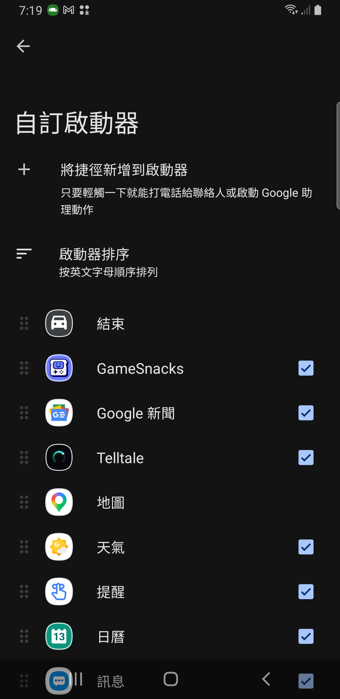

# Free APK installation evidence / 免費 APK 安裝證據

For installation steps and precautions, see the [shared guide / 安裝步驟與注意事項](../../free-apk-installation.md).

On 2026-10-13, Samsung Galaxy Note9 (Android 10 / API 29) with Android Auto 17.8.663874-release showed and checked Telltale in the phone's **Customize launcher** settings after a classic KingInstaller 2.3 overlay of the same official GitLab 1.0.19 arm64 APK. It remained visible after revoking KingInstaller's temporary storage read/write and install-source permissions. Direct installation and all three Android Auto developer/unknown-source settings stages had not made it visible.

2026-10-13，Samsung Galaxy Note9（Android 10 / API 29）、Android Auto 17.8.663874-release 使用 KingInstaller 2.3 的一般 classic／Google installer，同簽章覆蓋同一份官方 GitLab 1.0.19 arm64 APK 後，Telltale 出現在手機的「**自訂啟動器**」並已勾選；撤回 KingInstaller 臨時儲存讀寫與安裝來源權限後仍可見。直接安裝及三階段 Android Auto 開發／未知來源設定皆未讓它顯示。

[Public test receipt / 公開測試收據](test-receipt.json) records the exact APK hashes, versions, settings comparison and acceptance limits. The installer field changed from `null` to `com.android.vending`; this does not establish official Play distribution or purchase. UID, data inode, first-install time and package permissions were retained, but app-data contents were not audited.

[公開測試收據](test-receipt.json) 記錄 APK 雜湊、版本、設定比較與驗收範圍。installer 欄位由 `null` 變成 `com.android.vending`，不代表正式 Play 分發或購買。UID、資料 inode、首次安裝時間與套件權限保留，但未稽核 App 資料內容。

The image below is an original **phone settings capture**, not a head-unit image. This experiment did not run DHU, a physical head unit, a real vehicle or an OBD connection. No new target `CAR.VALIDATOR` lines were returned after overlay or cleanup, so a positive validator PASS is **NOT_ESTABLISHED**. OBD's IoT category approval remains **UNRESOLVED**. Version 1.0.20 was not tested with this method; results are not guaranteed for other devices or Android Auto versions.

下圖是原始**手機設定畫面**，不是車機畫面。本次未測 DHU、實體車機、實車或 OBD 連線；覆蓋與撤權後均未擷取到新的目標 `CAR.VALIDATOR` 訊息，因此正向 validator PASS 為 **NOT_ESTABLISHED**。OBD 的 IoT 類別審核仍為 **UNRESOLVED**。1.0.20 未以此方法測試，也不保證其他手機或 Android Auto 版本結果相同。



Screenshot SHA-256 / 截圖 SHA-256:

```text
25e49779990fdb497da3e5dbb3b6591b27acf196ea14cb00d77b731336a3674f
```

The public receipt was newly produced from an explicit allowlist of observations in the original local installation and settings-comparison receipts. Specific device serials, UID/inode values, first-install timestamps, private paths, full logs and credentials were excluded; retention indicators are booleans. The original PNG was manually reviewed for private identifiers and copied byte-for-byte without cropping, editing or re-encoding. It contains a phone clock and notification icons, but no account, device serial or personal filename. The source receipts and device dumps remain outside this public packet. The JSON and this README are checked with the project's `public_artifact_guard.py` as `public-summary`; the guard does not inspect PNG pixels.

公開收據由原始本機安裝與設定比較收據中的白名單觀察重新產生；排除裝置序號、實際 UID／inode 值、首次安裝時間、私人路徑、完整日誌及憑證，保留狀態只寫成布林。原始 PNG 已人工檢查私人識別資訊，直接逐位元組複製，未裁切、編輯或重新編碼。畫面有手機時鐘和通知圖示，但無帳戶、裝置序號或私人檔名。原始收據與裝置 dump 不在本公開證據包內。JSON 與本 README 使用專案 `public_artifact_guard.py` 的 `public-summary` 檢查；此檢查器不檢查 PNG 像素。

Original Library attachments were not delivered: the upload service was unavailable and no Library file IDs were confirmed. These repository files are the public evidence packet, not a claim that the original Library attachments were uploaded.

原 Library 附件未交付：上傳服務不可用，未確認任何 Library file ID。本目錄提供公開證據，不表示原 Library 附件已上傳。
